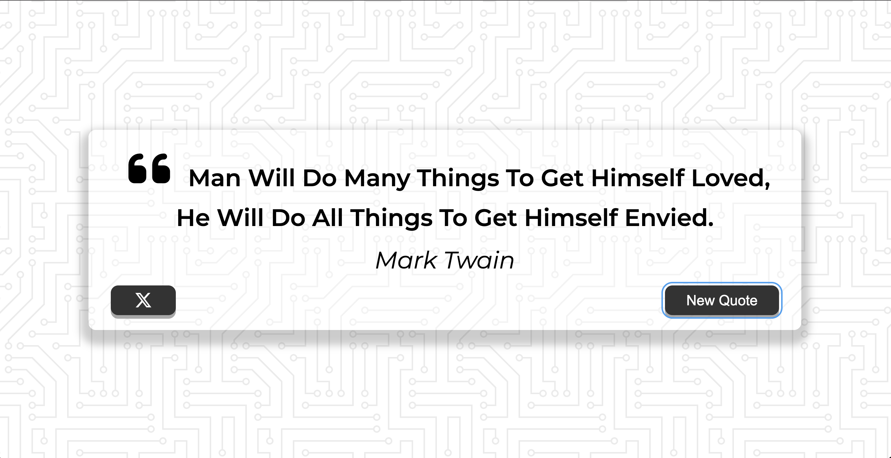

# Quote Generator

Shows an inspiring quote and lets you get a new one or share it on X.

**[Live demo](https://souravxdev.github.io/JavaScript-Projects/01-quote-generator/)** · ✅ Complete

## Features

- [x] Random quote from the [DummyJSON](https://dummyjson.com/docs/quotes) API
- [x] "New Quote" button
- [x] Loader while quotes are loading
- [x] Fixed-size card, so the buttons never move
- [x] Long quotes shrink to fit the card
- [x] Share the quote on X
- [x] Responsive layout, visible keyboard focus

## Built with

HTML, CSS (Flexbox, media queries) and vanilla JavaScript (`fetch`, `async/await`).

## What I learned

- Fetching data with `fetch` and `async/await`, and handling errors with `try/catch`.
- Showing a loader while waiting for the API, using the `hidden` attribute.
- Using `textContent` for API data so it can't inject HTML.
- Building a share link with `encodeURIComponent`.

## Next improvements

- Keep the quotes and current quote in a `state` object and draw the card from it with `render()`.
- Check `response.ok` and show errors in the card instead of `alert()`.
- Name magic values as constants (`API_URL`, `LONG_QUOTE_LENGTH`).
- Never show the same quote twice in a row.
- Use `<blockquote>` and `<figcaption>` for the quote, and `aria-live` so screen readers hear new quotes.

## Credits

- Background pattern "Circuit Board" by Steve Schoger, [Hero Patterns](https://heropatterns.com), CC BY 4.0
- Icons: [Font Awesome](https://fontawesome.com) · Font: [Montserrat](https://fonts.google.com/specimen/Montserrat)
